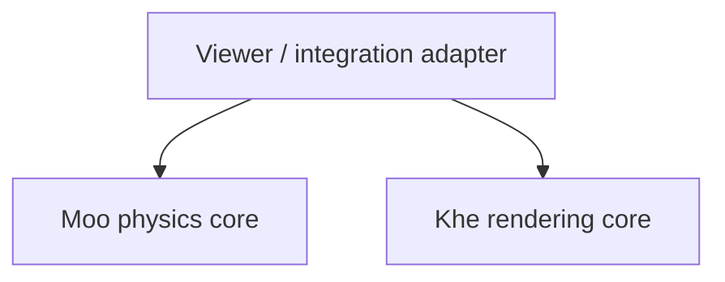

# Engine boundaries and development order

## Current dependency

Khe currently depends on a pinned Git revision of Moo. Moo does not depend on Khe. There is no circular dependency.

Khe's `window` and `backend` modules construct and control Moo simulations. The rendering pipeline in `renderer.rs` does not directly import Moo, but the current Khe crate still includes the viewer and its mandatory Moo dependency. Repository separation alone has not made the rendering crate independent.

## Intended boundary

Both engine cores should be independently usable. The viewer or integration adapter depends on both engines and translates simulation output into rendering inputs.

Arrows mean “depends on.” There should be no dependency between the two engine cores.

- **Moo** owns physical state, laws, material models, constraints, integration, simulation time, and physical diagnostics. It must run and validate without Khe, a window, or a graphics surface.
- **Khe** owns render scenes, cameras, geometry, materials, lighting, and image generation. Its core must accept scenes without constructing a Moo simulation.
- **Integration** owns conversion from Moo snapshots or explicitly described GPU buffers into Khe scenes, and routes user commands through Moo's public control API.

The first adapter can remain in the Khe repository as a separate feature or crate. A third repository is not required yet. The existing direct Khe-to-Moo dependency is transitional and must not gain a reverse dependency.

Shared GPU resources are an optional optimization, with explicit layout, units, coordinate conventions, ownership, lifetime, and synchronization rules. A shared `wgpu` dependency does not create an engine-to-engine dependency. Moo's compute device must not require a renderer-owned surface.

## Development order

### 1. Make existing Moo execution correct

Resolve GPU bindings and neighbor lookup (#6), initialization and playback (#7), exact stepping/configuration/time semantics (#8), and particle-count correctness (#9). Establish trustworthy GPU readback and completion reporting (#12). Remove unused window/audio dependencies from the physics package as part of headless dependency cleanup.

Acceptance: a fresh headless simulation initializes correctly; a requested step count advances exactly that many steps; GPU neighbor/pressure regressions pass; supported particle counts and invalid inputs are tested; results can be inspected without rendering.

### 2. Establish physical validation and reusable interfaces

Define units, assumptions, material parameters, boundary conditions, and validity ranges. Validate existing models against reference cases, timestep/resolution convergence, and appropriate conservation or dissipation checks (#10). Compare CPU and GPU results only when they implement the same model.

Develop general state, model, solver, and diagnostic interfaces from those validated cases. Introduce new physical domains incrementally, each with its own acceptance tests. A coupled fluid/deformable-solid demonstration is a later capability, not the initial correctness gate.

### 3. Make bulk execution reliable and measurable

Complete deterministic command ordering, reproducible configurations, checkpoint/export support, and scripting/control APIs (#12). Measure completed GPU work and end-to-end throughput across workload sizes before optimizing (#9). Document reproducibility tolerances across hardware and backends rather than promising bitwise GPU determinism.

### 4. Integrate Khe and expand rendering

Define a small, versioned simulation-to-render contract from Moo's validated output. Isolate the viewer/adapter from Khe's rendering core, fix the render data-layout defect, and add integration/visual regression cases. Then advance materials, lighting, fluid surfaces, and realistic rendering.

During the physics-first phase, Khe receives maintenance needed to preserve its build and inspect simulations. Advanced rendering work follows the Moo foundation.

## Tracking

- [Moo engine roadmap](https://github.com/KheMoos/Moo/issues/13)
- [Khe rendering roadmap](https://github.com/KheMoos/Khe/issues/2)

This is the intended architecture and work order. It does not claim that the core/adapter separation or physical validation is already complete.
